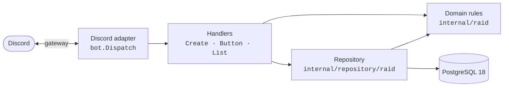

# DestinyScheduler

[](https://github.com/thonycsdev/DestinyScheduler/actions/workflows/ci.yml)


[](LICENSE)

**A Discord bot that schedules Destiny 2 raids across time zones.** A raid leader picks a raid, a date and a time in their own zone. Every member of the fireteam then sees that start time in *their* local time.

> "Raid at 9." *Whose* 9? A fireteam spread across São Paulo, Lisbon and New York has that argument every week. DestinyScheduler ends it.

---

## How it works

```
/raid create  raid: Vault of Glass   date: 2026-11-07   time: 21:00   timezone: America/Sao_Paulo
```

The bot posts a raid card in the channel:

```
▌ Vault of Glass
▌
▌ When
▌ Saturday, November 7, 2026 7:00 PM (in 3 days)
▌
▌ Fireteam (3/6)
▌ 👑 @Leader
▌ @Guardian2
▌ @Guardian3
▌
▌ Times are shown in your local time zone.

  [ Join ]  [ Leave ]  [ Cancel ]
```

That's how a member in New York sees it. The leader in São Paulo sees **9:00 PM**, and a member in Lisbon sees **Sunday 12:00 AM**. It's the same message, and everyone sees the right time.

The bot converts the time to UTC once and stores it. Discord then renders it with [timestamp markup](https://discord.com/developers/docs/reference#message-formatting-timestamp-styles) (`<t:UNIX:F>`), so the conversion happens in each viewer's client, in their own time zone, with daylight saving already applied. The bot never has to know where anyone lives.

### Features

- **`/raid create`**: schedule any of the current Destiny 2 raids (Last Wish through The Desert Perpetual). The time-zone option autocompletes as you type and ignores accents, so `são p` finds `America/Sao_Paulo`.
- **Join / Leave / Cancel buttons**: the card updates in place. The fireteam caps at 6 and the Join button disables when it's full.
- **`/raid list`**: shows upcoming raids, soonest first, with relative countdowns. Only you see the reply.
- **Sensible rules**: you can't schedule in the past, the leader can't leave (they cancel instead), and only the leader or a moderator can cancel. The fireteam locks once the raid starts.
- **Quiet errors**: a refused action gets a private reply only the person who clicked can see, so the channel stays clean.

---

## Engineering highlights

- **Built test-first.** Every behavior started as a failing test. There are 49 tests, and each one is catalogued in [`docs/tests.md`](docs/tests.md) with the requirement it protects and the branch that introduced it.
- **Safe under concurrency.** If the last slot is open and ten people click Join at once, exactly one gets in. Membership changes run in a transaction that locks the raid row (`SELECT … FOR UPDATE`). A test fires 10 simultaneous joins and checks that 1 succeeds and 9 are refused, and it fails without the lock.
- **Time handled correctly.** Times are stored in UTC and parsed with the IANA zone rules for the raid's own date. Tests cover the 2026 daylight-saving changes in London and New York. The tz database is embedded in the binary, so time zones work even in minimal container images.
- **Real database in tests, no mocks.** Repository and handler tests run against a real PostgreSQL 18 started by [Testcontainers](https://testcontainers.com/), and each test starts from a clean state.
- **Versioned schema.** [goose](https://github.com/pressly/goose) SQL migrations are embedded in the binary, and a test checks that every one rolls back cleanly. On startup the bot checks the schema and refuses to run against a database that's behind.
- **CI/CD.** GitHub Actions runs `go vet` and the full test suite on every pull request. On `master` it then applies migrations to the production database through a protected GitHub environment, one run at a time.
- **Clean layering.** Discord is kept at the edge of the code (see below), so the core logic can be tested without a Discord connection.

---

## Architecture



| Layer | Package | Responsibility |
|---|---|---|
| Domain | `internal/raid` | Pure rules: scheduling, the 6-player fireteam, join/leave, time parsing. No Discord or database imports. |
| Persistence | `internal/repository/raid` | Saves and loads raids with [pgx v5](https://github.com/jackc/pgx), and applies domain rules inside row-locked transactions. |
| Schema | `internal/database` | Connection pool, embedded goose migrations, startup schema check. |
| Bot | `internal/bot` | Handlers are plain functions from an input struct to a `Response`, fully tested. `Dispatch` is a thin [discordgo](https://github.com/bwmarrin/discordgo) adapter. |
| Config | `internal/config` | Precedence: environment variable > `.env` (local secrets) > `.env.development` (committed defaults). |
| Entry points | `cmd/bot`, `cmd/migrate` | Run the bot; apply or roll back migrations. |

---

## Tech stack

**Go 1.26** · **PostgreSQL 18** · discordgo · pgx v5 · goose · Testcontainers · Docker Compose · GitHub Actions · `log/slog` structured logging

---

## Run it locally

**Prerequisites:** Go 1.26+, Docker, and a Discord application with a bot user ([create one here](https://discord.com/developers/applications)).

```sh
# 1. Start Postgres
docker compose up -d --wait

# 2. Apply the schema
go run ./cmd/migrate up

# 3. Add your bot's credentials to .env (git-ignored)
cat > .env <<'EOF'
DISCORD_TOKEN=your-bot-token
DISCORD_GUILD_ID=your-test-server-id
EOF

# 4. Run the bot
go run ./cmd/bot
```

Invite the bot to your server with the `bot` and `applications.commands` scopes. With `DISCORD_GUILD_ID` set, `/raid` registers in that server instantly. Leave it unset to register globally.

### Tests

```sh
go test ./...        # needs Docker running for the database tests
go vet ./...
```

---

## License

[MIT](LICENSE) © 2026 Anthony Coutinho da Silva
